# Weather App: Secure CI/CD Pipeline to Amazon ECS

A Jenkins pipeline that puts six security gates in front of a deployment to
Amazon ECS Fargate. A commit has to pass secret scanning, unit tests, SAST,
SCA, an image scan and a DAST scan before its image reaches ECR. Each gate
fails the build on Critical/High findings and archives its report either way.

This project extends [jenkins-cicd-lab](https://github.com/Smiley2507/jenkins-cicd-lab),
which built the same Flask app and deployed it to an EC2 host over SSH. Here
the app is unchanged and the delivery path around it is new: security gates,
ECR instead of Docker Hub, and ECS task definition revisions instead of
`docker run` on a server.

---

## Contents

- [What the lab asks for, and where it is](#what-the-lab-asks-for-and-where-it-is)
- [Architecture](#architecture)
- [The pipeline](#the-pipeline)
- [The security gates](#the-security-gates)
- [Deploying to ECS](#deploying-to-ecs)
- [Infrastructure](#infrastructure)
- [Security decisions](#security-decisions)
- [Repository layout](#repository-layout)
- [How to reproduce](#how-to-reproduce)
- [Evidence](#evidence)
- [Known limitations](#known-limitations)

---

## What the lab asks for, and where it is

| Requirement | Where |
|---|---|
| Same app, tests and Dockerfile; images in ECR | [`app/`](app/), [`terraform/modules/ecr`](terraform/modules/ecr) |
| SAST | SonarQube, *SAST* stage in the [Jenkinsfile](Jenkinsfile) |
| SCA | Snyk, *SCA* stage |
| Image scan | Trivy, *Image Scan* stage |
| Secret scan | Gitleaks, *Secret Scan* stage |
| SBOM | Syft (CycloneDX JSON), *SBOM* stage |
| Fail on Critical/High or secrets; archive reports | Every gate exits non-zero; `post { always { archiveArtifacts 'reports/**' } }` |
| Versioned image tags pushed to ECR | `BUILD_NUMBER-SHORT_SHA`, immutable tags |
| Render and register a task definition revision | [`ecs/taskdef.template.json`](ecs/taskdef.template.json), [`scripts/render-taskdef.sh`](scripts/render-taskdef.sh) |
| Update the ECS service (rolling) | [`scripts/deploy-ecs.sh`](scripts/deploy-ecs.sh), circuit breaker with rollback |
| Logs to CloudWatch via the ECS log driver | `awslogs` driver → `/ecs/weather-app` |
| Alarms reflect the deployment | [`terraform/modules/ecs-alarms`](terraform/modules/ecs-alarms) |
| Inject a vulnerable dependency, then fix | [Evidence](#evidence), runbook §5 |
| Clean up old images and revisions | ECR lifecycle policy, [`scripts/cleanup-taskdefs.sh`](scripts/cleanup-taskdefs.sh) |
| **Extra:** DAST | OWASP ZAP baseline, *DAST* stage |

---

## Architecture

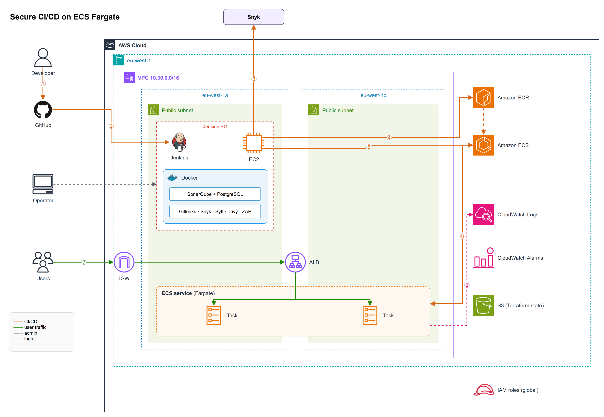

1. A developer pushes to `main` on GitHub.
2. Jenkins checks out the commit on the EC2 host.
3. The security gates run in Docker on the same host. Snyk is the only one that calls out to a SaaS API.
4. The image is pushed to ECR with an immutable `{build}-{sha}` tag.
5. Jenkins registers a new task definition revision and updates the ECS service.
6. ECS rolls the new tasks out, pulling the image from ECR. The circuit breaker rolls back a failed rollout.
7. Users reach the tasks through the internet gateway and the ALB (port 80 → 8000).
8. Tasks log to CloudWatch Logs, and CloudWatch alarms watch the service and the ALB.

ECR, the ECS control plane, CloudWatch and S3 are regional managed services, so they sit
outside the VPC. Only the Fargate tasks (one network interface each) and the Jenkins host
live in the subnets. IAM is global. The source is
[diagrams/architecture.drawio](diagrams/architecture.drawio) and opens in draw.io.

| Layer | Tool | Runs |
|---|---|---|
| Infrastructure | Terraform, split into local modules | Once per environment |
| Host configuration | Ansible (Jenkins, SonarQube, CloudWatch agent) | Once, after Terraform |
| Delivery | Jenkins | Every build |

Terraform creates the ECS service on a placeholder task definition. From the
first green build on, Jenkins owns the task definition and Terraform ignores
which revision the service points at.

---

## The pipeline

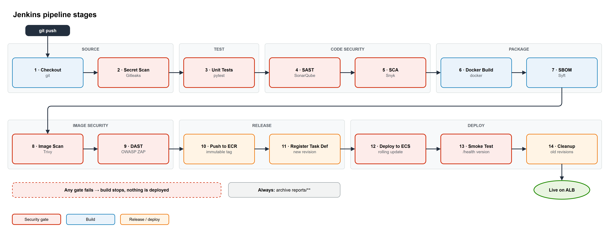

Everything before **Push to ECR** is a gate. A failure anywhere there stops
the build before an image exists in the registry, so a blocked change can
never be deployed, not even by accident or by a later manual step.

Each scanner runs as a **pinned Docker image**. The Jenkins host needs Docker
and the AWS CLI, and no scanner is installed on it. Upgrading a scanner is a
one-line change to the `environment` block of the Jenkinsfile.

Every gate writes its report **before** it fails. Combined with
`archiveArtifacts` in `post { always }`, this means a red build still carries
the evidence of why it went red.

---

## The security gates

| Gate | Tool | Examines | Fails the build when | Report |
|---|---|---|---|---|
| Secrets | Gitleaks 8.30 | Full git history | Any finding | `gitleaks.json` |
| SAST | SonarQube Community 26.9 | Python source, Dockerfile, HTML | Quality gate *Strict* fails | `sonar-quality-gate.json`, `sonar-issues.json` |
| SCA | Snyk (Open Source) | `app/requirements.txt`, resolved | Any High or Critical | `snyk.json`, `snyk-summary.txt` |
| SBOM | Syft 1.54 | The built image | (not a gate) | `sbom.cdx.json` (CycloneDX) |
| Image scan | Trivy 0.75 | OS packages and libraries in the image | High or Critical **with a fix available** | `trivy.json`, `trivy.txt` |
| DAST | OWASP ZAP 2.16 baseline | The running container, over HTTP | Any High-risk alert, or a rule set to FAIL | `zap/zap.html`, `zap/zap.json` |

### Gate policies and why

**Gitleaks scans history, not just the working tree.** A key that was
committed and then deleted is still in the repository, and still has to be
rotated. The allowlist in [`security/.gitleaks.toml`](security/.gitleaks.toml)
excludes only `reports/`, since generated scanner output can quote matched
strings back.

**SonarQube uses a custom gate, `Strict`, on overall code.** The built-in
*Sonar way* gate only checks *new* code, and on a project's first analysis
nothing is new, so it always passes. *Strict* fails when the Security or
Reliability rating of the **whole codebase** is worse than A, or when an
analysis introduces new issues. `sonar.qualitygate.wait=true` makes the
scanner itself exit non-zero, so no webhook back to Jenkins is needed.

The gate did its job on the first real analysis (build #4): it failed with
**Security Rating D**, caused by one Security/High finding, rule
`python:S4502`, *"Make sure disabling CSRF protection is safe here"*, on the
form handler in `app.py`. It was reviewed and **accepted, not fixed**:
CSRF lets an attacker make a logged-in user's browser perform a
state-changing action. This app has no logins, no sessions and no cookies,
and its only POST is a read-only weather lookup, so a forged request can do
nothing a direct request could not. Six maintainability findings were
accepted at the same time. Build #5 then passed with Security and
Reliability back at A. ZAP reports the same thing independently, as
*Absence of Anti-CSRF Tokens* (Medium).

**Trivy ignores vulnerabilities with no fix.** The `python:3.12-slim` base
(Debian 13) carries HIGH CVEs that Debian has not yet patched. When this was
written there were 44, all unfixed. No change in this repository can resolve
them, so blocking on them would block every build forever and the gate would
stop meaning anything. They still appear in full in `trivy.txt`. Any
fixable HIGH/CRITICAL, in the OS or in a Python package, fails the build.
Accepted exceptions go in [`security/.trivyignore`](security/.trivyignore)
with a reason and an expiry date.

**ZAP scans the image before it is pushed, not the live site after it is
deployed.** The pipeline starts the freshly built image as a throwaway
container on a private Docker network and points the ZAP baseline scan at it.
DAST against production would find problems only after they had shipped. The
baseline scan is passive (it observes responses and does not attack), and it
takes about two minutes. Plain warnings are reported but do not block;
[`security/zap-rules.tsv`](security/zap-rules.tsv) lists the few rules that
are promoted to FAIL or ignored, each with a reason.

---

## Deploying to ECS

### Task definition

[`ecs/taskdef.template.json`](ecs/taskdef.template.json) is the single source
for every revision. It has seven placeholders:

| Placeholder | Value |
|---|---|
| `${TASK_FAMILY}` | `weather-app` |
| `${IMAGE_URI}` | `<account>.dkr.ecr.eu-west-1.amazonaws.com/weather-app:<BUILD>-<SHA>` |
| `${APP_VERSION}` | the image tag, returned by `/health` |
| `${EXEC_ROLE_ARN}` / `${TASK_ROLE_ARN}` | from `terraform/modules/ecs-task-roles` |
| `${LOG_GROUP}` / `${AWS_REGION}` | `/ecs/weather-app`, `eu-west-1` |

[`scripts/render-taskdef.sh`](scripts/render-taskdef.sh) fills them with
`envsubst`, given the explicit list so it touches nothing else. It refuses to
render if any value is unset, and it refuses to write a file that is not
valid JSON or still contains a `${`. The rendered JSON for each build is
archived as `reports/taskdef-<tag>.json`. A sample is committed in
[`ecs/rendered/`](ecs/rendered/).

### Rollout

[`scripts/deploy-ecs.sh`](scripts/deploy-ecs.sh):

1. `aws ecs register-task-definition`, which creates a new revision.
2. `aws ecs update-service --task-definition <new revision>`.
3. `aws ecs wait services-stable`.
4. **Checks that the new revision is actually the one running.** If the new
   tasks never become healthy, the deployment circuit breaker rolls the
   service back to the previous revision, and the service then reports
   *stable*, on the old revision. The waiter alone would call that a success.
   The script compares the PRIMARY deployment's task definition and
   `rolloutState` with what it just registered, and fails the build if they
   differ.

The rolling update keeps capacity up the whole time: minimum healthy 100%,
maximum 200%, so new tasks start and pass health checks before old ones
stop. The **Smoke Test** stage then asks the ALB for `/health` until it sees
the new version four times in a row, so both tasks are known to be serving it.

### Logs and alarms

Containers log to CloudWatch through the `awslogs` driver, in group
`/ecs/weather-app` with stream prefix `web`. The app already writes one JSON
line per request, so the logs can be queried in Logs Insights as they are.

Three CloudWatch alarms watch the service. After a good deploy all three
stay in OK; a bad one that slipped past the gates would trip them:

| Alarm | Metric | Fires when |
|---|---|---|
| `…-running-tasks-low` | `ECS/ContainerInsights` RunningTaskCount | Fewer tasks running than desired, for 3 minutes |
| `…-5xx` | `AWS/ApplicationELB` HTTPCode_Target_5XX_Count | More than 5 server errors in 5 minutes |
| `…-unhealthy-targets` | `AWS/ApplicationELB` UnHealthyHostCount | Any target failing health checks, for 3 minutes |

### Cleanup

- **Images:** the ECR lifecycle policy expires untagged images after one day
  and keeps the ten most recent tagged images.
- **Task definition revisions** have no lifecycle policy, so the last stage
  runs [`scripts/cleanup-taskdefs.sh`](scripts/cleanup-taskdefs.sh). It
  deregisters every ACTIVE revision except the newest three, and never the
  one the service is running.
  `list-task-definitions --family-prefix weather-app` would also return
  Terraform's `weather-app-bootstrap` family, because it is a prefix match,
  so the script keeps only exact-family ARNs.

---

## Infrastructure

Terraform in [`terraform/`](terraform/), with state in S3 (encrypted,
`use_lockfile` locking). The root files only call modules:

| Root file | Module | Creates |
|---|---|---|
| `network.tf` | `network` | VPC, 2 public subnets in 2 AZs, IGW, route table |
| `security.tf` | `security-group` ×3 | ALB, tasks and Jenkins security groups |
| `ecr.tf` | `ecr` | Repository (immutable tags, scan on push) and lifecycle policy |
| `alb.tf` | `alb` | ALB, IP target group, HTTP listener |
| `ecs.tf` | `ecs-service` | Cluster (Container Insights), bootstrap task definition, service |
| `iam.tf` | `ecs-task-roles`, `instance-role` | Execution and task roles; the Jenkins instance profile |
| `ec2.tf` | `key-pair`, `ec2-instance` | SSH key; the Jenkins + SonarQube host |
| `cloudwatch.tf` | `log-group` ×2, `ecs-alarms` | Log groups and the three alarms |

Ansible in [`ansible/`](ansible/) configures the one EC2 host using a dynamic
EC2 inventory. The `common`, `jenkins` and `cloudwatch_agent` roles come from
the previous project; `sonarqube` is new: kernel limits, then SonarQube with
PostgreSQL under Docker Compose.

---

## Security decisions

| Decision | Why |
|---|---|
| **No AWS access keys anywhere** | Jenkins uses an EC2 instance role; tasks use ECS task roles. Nothing to leak or rotate. |
| **Least-privilege Jenkins role** | ECR push only to this repository; `UpdateService` only on this service; `iam:PassRole` only for the two task roles, and only to `ecs-tasks.amazonaws.com`. |
| **IMDSv2 only, hop limit 1** | Containers on the Jenkins host, including every scanner, cannot reach the instance role's credentials. |
| **Security groups chained by reference** | The tasks accept port 8000 only from the ALB's security group. They have public IPs, since there is no NAT gateway, but they are reachable only through the load balancer. |
| **Operator access limited to one IP** | SSH, Jenkins and SonarQube are open only to the public IP of whoever runs Terraform, looked up at plan time with a `data "http"` source. |
| **Immutable image tags** | A tag always means the same image, so a task definition revision can never silently change underneath. |
| **Scanners run as the `jenkins` uid** | Files they write into the workspace stay owned by Jenkins, and nothing runs as root that does not have to. |
| **Gates before push** | A blocked image never reaches the registry. |

---

## Repository layout

```
app/                        Flask app, tests, Dockerfile (from jenkins-cicd-lab)
Jenkinsfile                 the pipeline
ecs/taskdef.template.json   task definition template
ecs/rendered/               sample rendered revision
scripts/                    render-taskdef, deploy-ecs, cleanup-taskdefs
security/                   Gitleaks, Trivy and ZAP configuration
sonar-project.properties    SonarQube project settings
terraform/                  root config + modules/
ansible/                    Jenkins + SonarQube host configuration
diagrams/                   architecture and pipeline diagrams (draw.io + PNG)
reports/                    sample security reports and SBOM (evidence)
screenshots/                evidence
runbook.md                  step-by-step bring-up, gate tests, teardown
```

---

## How to reproduce

[runbook.md](runbook.md) covers every step. In short:

```bash
export AWS_PROFILE=sandbox-user
cd terraform && terraform init && terraform apply
cd ../ansible && pip install -r requirements.txt \
  && ansible-galaxy collection install -r requirements.yml \
  && ansible-playbook site.yml
```

Then, once, in the web UIs: create the SonarQube *Strict* gate and a token,
add the `sonar_token` and `snyk_token` credentials to Jenkins, and create a
pipeline job pointing at this repository's `Jenkinsfile`.

Approximate running cost is $3–4 a day (t3.large, ALB, two small Fargate
tasks). Run `terraform destroy` when finished.

---

## Evidence

Screenshots are in [`screenshots/`](screenshots/). The reports from the
green build (#5, image tag `5-4cc6476`) are committed unmodified in
[`reports/`](reports/), exactly as Jenkins archived them.

### 1. A gate blocking deployment, then passing

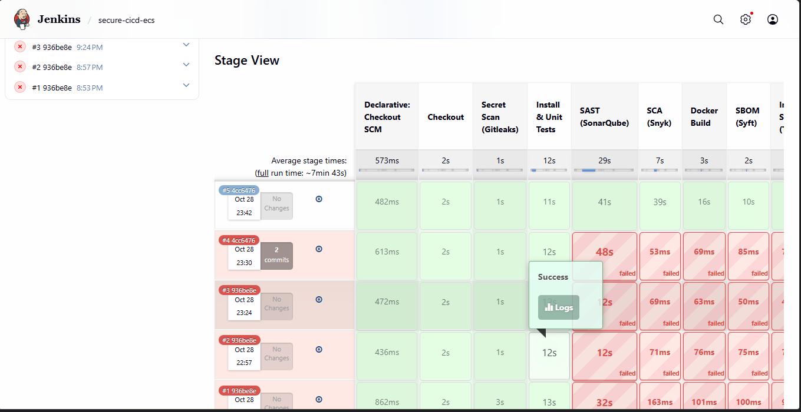

Builds **#1–#4** stop at **SAST (SonarQube)**, and every later stage is
skipped. Nothing was built, pushed or deployed. #1–#3 were pipeline
configuration problems (the scanner's working directory, fixed in `4cc6476`).
**#4 is the gate itself failing**: the analysis completed and the quality
gate returned `ERROR` on Security Rating D.

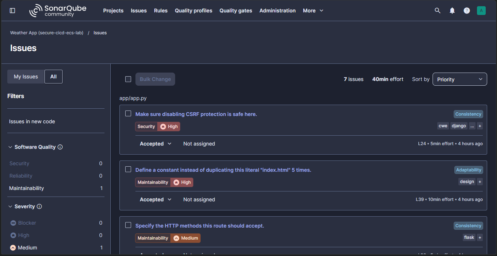

The findings behind the failure, after review. The CSRF finding is
Security/High; the reasoning for accepting it is under
[Gate policies](#gate-policies-and-why).

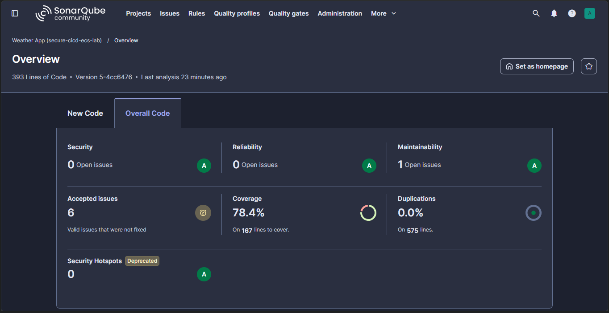

Build **#5** (`5-4cc6476`) after the review: Security **A**, Reliability
**A**, 78.4% coverage, 0.0% duplication. Every stage then ran and passed.

### 2. Injected vulnerable dependency: blocked, then fixed

The lab's required test, run as three commits on `main`:

| Build | Commit | Change | Result |
|---|---|---|---|
| #6 | `447046e` | Add `PyYAML==5.3.1` to `app/requirements.txt` | **Failed at SCA (Snyk)**, nothing built, pushed or deployed |
| #7 | `aeec6b5` | Revert it | Passed all six gates, then failed at *Deploy to ECS* (see below) |
| #8 | `9891730` | Fix the deploy script | **Green**, deployed as `weather-app:2` |

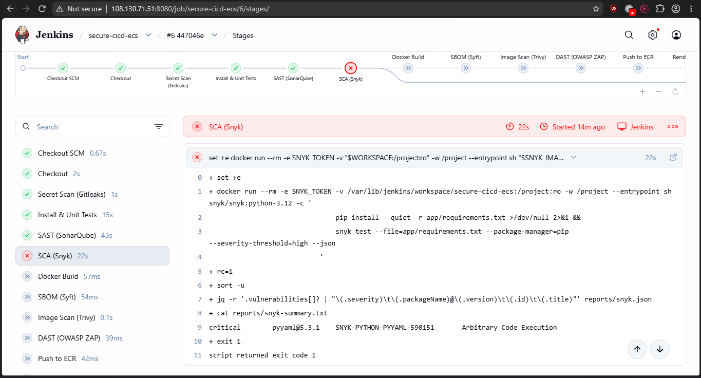

Snyk reported **critical** `SNYK-PYTHON-PYYAML-590151`, *Arbitrary Code
Execution*: CVE-2020-14343, CVSS 9.8, fixed in 5.4
([`reports/failed-build-6/snyk.json`](reports/failed-build-6/snyk.json)).
Every stage after SCA was skipped. Afterwards, the service was still on
`weather-app:1`, ECR had no `6-447046e` image, and `/health` still answered
`5-4cc6476`
([`reports/failed-build-6/ecs-unchanged.txt`](reports/failed-build-6/ecs-unchanged.txt)).

Build #7, with the dependency removed, got through every security gate and
pushed its image. It then failed at *Deploy to ECS* with `Permission denied`:
a previous commit had dropped the executable bit from
`scripts/deploy-ecs.sh`. That was a repository mistake, unrelated to the
gates, and nothing was deployed. `9891730` restored the bit.

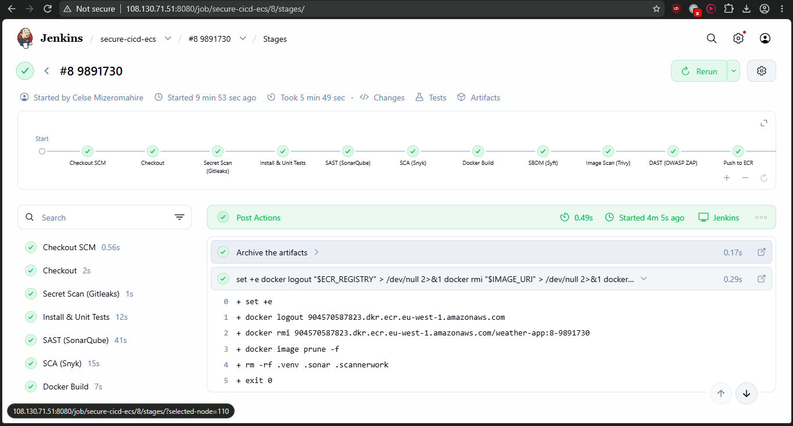

Build **#8** passed every gate (Snyk: 0 vulnerabilities) and deployed
`8-9891730` as **`weather-app:2`**
([`reports/build-8/`](reports/build-8/)).

### 3. Security reports from the first green build (#5)

| Gate | Result | Report |
|---|---|---|
| Gitleaks | No leaks, 4 commits scanned | [`gitleaks.json`](reports/gitleaks.json) |
| Unit tests | 37 passed | [`test-results.xml`](reports/test-results.xml), [`coverage.xml`](reports/coverage.xml) |
| SonarQube | Gate `OK`: Security A, Reliability A, 1 open minor issue | [`sonar-quality-gate.json`](reports/sonar-quality-gate.json), [`sonar-issues.json`](reports/sonar-issues.json) |
| Snyk | 35 dependencies, **0** High/Critical | [`snyk.json`](reports/snyk.json) |
| Syft | CycloneDX 1.7 SBOM, 2,872 components | [`sbom.cdx.json`](reports/sbom.cdx.json) |
| Trivy | **0** fixable High/Critical (gate). 44 HIGH in Debian base packages with no fix yet, listed in full | [`trivy.json`](reports/trivy.json), [`trivy.txt`](reports/trivy.txt) |
| ZAP | **0** High. 3 Medium: anti-CSRF tokens, CSP, anti-clickjacking header | [`zap/zap.html`](reports/zap/zap.html), [`zap/zap.json`](reports/zap/zap.json) |

### 4. Task definition revision and ECS deployment

The rendered revision for this build is
[`ecs/rendered/taskdef-5-4cc6476.json`](ecs/rendered/taskdef-5-4cc6476.json),
registered as `weather-app:1`:

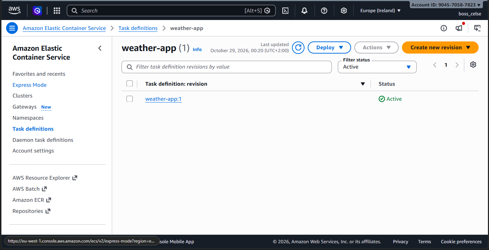

The service moved from Terraform's placeholder (`weather-app-bootstrap:1`)
to `weather-app:1`, with 2 of 2 tasks running and deployment status
*Success*:

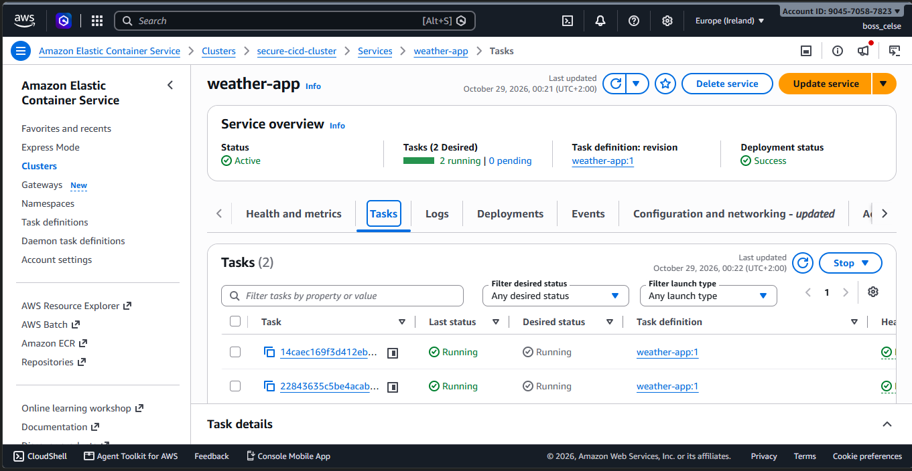

The same rollout from the AWS API, from
[`reports/ecs/describe-services.json`](reports/ecs/describe-services.json):

```
PRIMARY  COMPLETED  weather-app:1  running=2/2
21:48:58  deregistered 1 targets in (target-group .../secure-cicd-tg/...)
21:48:58  has begun draining connections on 1 tasks.      ← old placeholder tasks
21:49:59  (deployment ecs-svc/...) deployment completed.
21:49:59  has reached a steady state.
```

Build #8 repeated this with the next revision. Template rendered to
[`ecs/rendered/taskdef-8-9891730.json`](ecs/rendered/taskdef-8-9891730.json),
registered as `weather-app:2`, rolled out to PRIMARY / COMPLETED with 2/2
running ([`reports/build-8/ecs/describe-services.json`](reports/build-8/ecs/describe-services.json)).
The two rendered files differ only in the image tag and `APP_VERSION`.

### 5. The new version is live

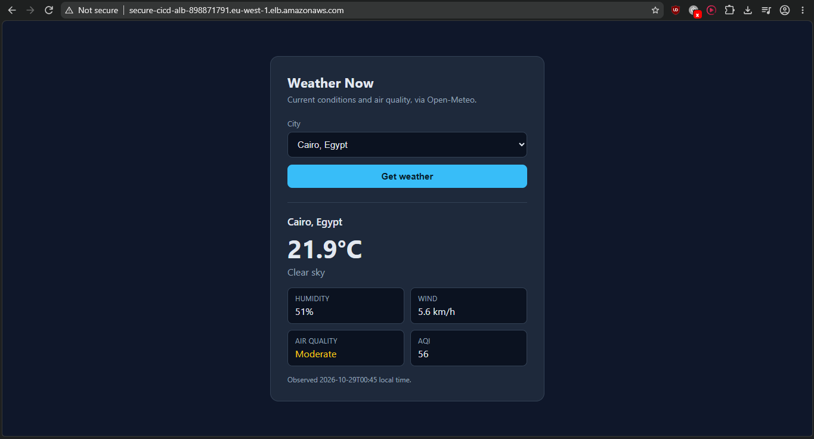

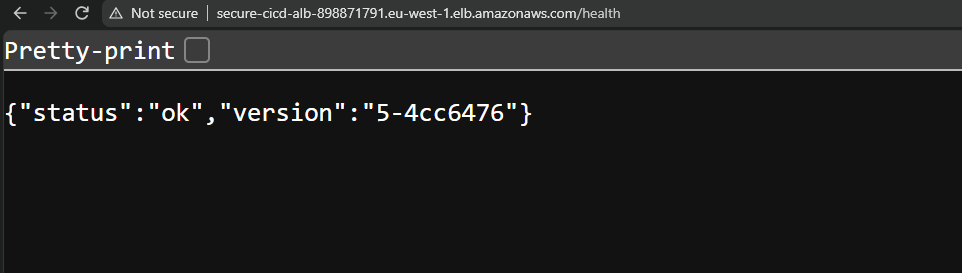

`/health` reports `5-4cc6476`, the Jenkins build number and commit, which is
also the ECR image tag and the `APP_VERSION` in the task definition. The
smoke test stage required four consecutive matching responses
([`reports/ecs/health.json`](reports/ecs/health.json)). After build #8 it
returns `8-9891730`
([`reports/build-8/ecs/health.json`](reports/build-8/ecs/health.json)).

### 6. Logs, alarms and cleanup

Captured with the AWS CLI after build #8, in [`reports/aws/`](reports/aws/):

| Item | Evidence |
|---|---|
| Container logs in CloudWatch | [`ecs-app-logs.txt`](reports/aws/ecs-app-logs.txt): the app's JSON request lines and gunicorn's access log, read from `/ecs/weather-app`. [`log-streams.txt`](reports/aws/log-streams.txt) lists the `web/weather-app/<task-id>` streams the `awslogs` driver created, one per task. |
| Alarms through the deployments | [`alarms.txt`](reports/aws/alarms.txt): all three alarms **OK**. None changed state during the rollouts of builds #5 and #8. |
| ECR images and lifecycle policy | [`ecr-images.txt`](reports/aws/ecr-images.txt): `5-4cc6476`, `7-aeec6b5`, `8-9891730`, and no `6-447046e`, because the gate blocked it before the push. [`ecr-lifecycle-policy.json`](reports/aws/ecr-lifecycle-policy.json): the policy as applied. |
| Task definition cleanup | [`taskdef-cleanup.txt`](reports/aws/taskdef-cleanup.txt): after build #8 was validated, `cleanup-taskdefs.sh weather-app 1` deregistered `weather-app:1` (now INACTIVE) and kept `weather-app:2`, the revision in use. The pipeline runs the same script on every build with *keep 3*, so it only removes revisions once more than three exist. |

---

## Known limitations

- **Single Jenkins host.** Jenkins and SonarQube share one t3.large, and builds
  run on the built-in node. Production would use separate agents.
- **HTTP only.** The ALB listens on port 80. HTTPS needs a domain and an ACM
  certificate.
- **No NAT gateway.** Tasks run in public subnets with public IPs, protected by
  security groups. A NAT gateway or VPC endpoints would allow private subnets
  at extra cost.
- **ZAP baseline is passive.** It finds missing headers and information
  leaks, not injection flaws. A full active scan belongs in a separate,
  longer-running job against a staging environment.
- **Missing security headers.** The three Medium ZAP findings are known and
  not yet fixed in the app.
- **Unfixed base image CVEs** are accepted by policy (see
  [Gate policies](#gate-policies-and-why)) and should be re-checked as Debian
  publishes fixes.
